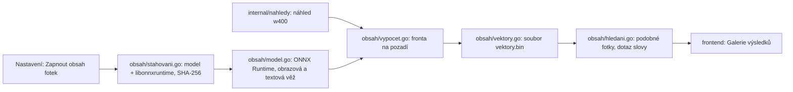

# Návrh: Obsah fotek – podobné fotky a hledání podle obsahu (obrazový model CLIP ViT-B/32)

Stav k 6. 11. 2026 (verze 1.2.72). **Nic z toho není rozhodnuté.** Návrh přehodnocuje položku z „Nedělat“
(ROADMAP, [NAVRH-NAPADY.md:638](NAVRH-NAPADY.md), [NAVRH-DOPORUCENI.md:433](NAVRH-DOPORUCENI.md),
[NAVRH-SITE.md:61](NAVRH-SITE.md)). Po potvrzení rozhodnutí z oddílu 9 se položka v „Nedělat“ přepíše
a etapy se přenesou do `ROADMAP.md`.

> **Rozhodnuto 6. 11. 2026:** model **CLIP ViT-B/32 int8** místo SigLIP a vektor pro **každou fotku sbírky**
> (všechna alba všech modelek, dnes 18 045 fotek – ne 64 000, jak počítají starší odhady níže). Model, hash,
> předzpracování, výkon a kvalita: [MODEL-CLIP-B32.md](MODEL-CLIP-B32.md). Kde níže stojí SigLIP, platí CLIP B/32
> (512 rozměrů, ~9 MB vektorů, výpočet celé sbírky ~1,5 h).

Pracnost: **S** do 2 hodin, **M** půl dne, **L** den a víc. **[schéma]** = mění databázi nebo export.

## 1. Shrnutí

- **Co uživatel dostane:** (a) „Podobné fotky“ z nabídky fotky – fotky ze sbírky, které vypadají podobně
  (stejné focení, podobná scéna, téměř duplikáty); (b) „Hledat ve fotkách“ – dotaz slovy („na pláži“,
  „červené šaty“, „černobílá“) vrátí galerii nejlépe odpovídajících fotek.
- **Model:** SigLIP (Google), kvantovaný na int8 ve formátu ONNX. Obrazová věž převede fotku na vektor
  (768 čísel), textová věž převede dotaz do téhož prostoru; podobnost = skalární součin.
- **Běhové prostředí:** ONNX Runtime přes `github.com/yalue/onnxruntime_go`. Knihovna `libonnxruntime.so`
  se **načítá za běhu** (dlopen), ne při linkování → sestavení programu se nemění; když knihovna nebo model
  chybí, funkce je jen vypnutá.
- **Stahování na vyžádání:** model i knihovna se stahují až po zapnutí funkce v Nastavení, na pozadí,
  s průběhem v okně, ověřením SHA-256 a možností přerušit a navázat. **Program se při startu nezamyká.**
- **Bez změny schématu i exportu** (úprava č. 12, export 8, `TestZmrazeniAlfy` beze změny): vektory jsou
  v samostatném souboru vedle databáze, klíčem je `drive_file_id`. Smazání souboru = funkce začne znovu.
- **Fotky neopouštějí počítač:** k výpočtu stačí náhled w400, který program už stahuje do mezipaměti
  ([internal/nahledy](../internal/nahledy/nahledy.go)).

## 2. Proč to dřív bylo v „Nedělat“ a co se změnilo

| Dřívější námitka | Stav teď |
|---|---|
| Model stovky MB | Obrazová věž SigLIP base int8 ~95 MB; textová věž podle volby v oddílu 4 (100–400 MB). Stahuje se jen na vyžádání. |
| Cizí runtime přes cgo | Program už cgo používá (Wails na Linuxu = WebKitGTK přes cgo). `onnxruntime_go` knihovnu otevírá až za běhu, takže build ani `zkontrolovat.sh` nové závislosti v systému nepotřebují. |
| Hodiny výpočtu na 64 000 fotek | Ano, ~1,5–3 h (oddíl 6) – ale jednorázově, na pozadí, po částech, s pokračováním po restartu. Nové fotky se dopočítají hned po přidání. |
| Varianta v cloudu = fotky třetí straně | Nic se neposílá; vše běží místně. |

## 3. Architektura



Nový balíček `internal/obsah` (stejně jako `internal/nahledy`; v `package main` jen tenké metody `App`):

| Soubor | Obsah |
|---|---|
| `stahovani.go` | Stahování souborů s průběhem (oddíl 5), ověření hashe, navázání přes `Range` |
| `model.go` | Inicializace ONNX Runtime, sezení obrazové a textové věže, předzpracování obrázku (zmenšení na 224×224 nebo 256×256, normalizace), tokenizace dotazu |
| `vypocet.go` | Fronta fotek bez vektoru, souběh 2–3 vlákna (ohled na limity Googlu i CPU), ukládání po dávkách |
| `vektory.go` | Soubor `vektory.bin`: hlavička (verze formátu, název a hash modelu, rozměr), záznamy `drive_file_id` + int8 vektor + měřítko; načtení do paměti (64 000 × 768 B ≈ 49 MB) |
| `hledani.go` | Nejbližší sousedé hrubou silou (64 000 × 768 ≈ 50 M operací, ~20–40 ms na 8 jádrech, index není potřeba) |

Metody `App` (Wails): `ObsahStav()`, `ObsahZapnout()`, `ObsahVypnout(smazat bool)`, `PodobneFotky(fotkaID, pocet)`,
`HledatVeFotkach(dotaz, pocet)`. Události: `obsah:stahovani` (procenta, bajty), `obsah:vypocet` (hotovo/celkem),
`obsah:chyba`.

### Proč ne do databáze

- Schéma je zmrazené (úprava č. 12) a zálohy kopírují celý soubor – 50–100 MB vektorů by každou zálohu
  zvětšilo několikanásobně.
- Vektory jsou odvozená data: dají se kdykoli spočítat znovu. Stejný princip už platí pro náhledy.
- Soubor je vázaný na model (hash v hlavičce); po změně modelu se zahodí a spočítá znovu.

## 4. Volba modelu (rozhodnutí 1)

Dotazy budou česky. SigLIP v základní verzi rozumí jen anglicky.

| Varianta | Velikost (int8) | Čeština | Poznámka |
|---|---|---|---|
| **A: SigLIP base (anglický) + překlad dotazu slovníkem** | ~95 MB obraz + ~110 MB text | přes vestavěný slovník česky → anglicky (pláž → beach, šaty → dress …), rozšiřitelný | nejmenší; dotazy mimo slovník nepůjdou |
| **B: SigLIP base multilingual** | ~95 MB obraz + ~370 MB text (slovník 250 000 tokenů) | přímo | nejpohodlnější, největší stahování a RAM (~1 GB při dotazu) |
| **C: Jen obrazová věž** | ~95 MB | netýká se | jen „Podobné fotky“ a duplikáty, bez hledání slovy; textová věž se dá přidat později bez přepočtu vektorů |

**Doporučení:** začít **C** (etapa 1), hledání slovy přidat jako etapu 2 ve variantě A nebo B podle zkušenosti.
Vektory fotek jsou pro všechny tři varianty stejné (stejná obrazová věž), takže se nic nepočítá dvakrát.

Tokenizace (A, B): SigLIP používá SentencePiece; v Go čistá implementace `github.com/eliben/go-sentencepiece`
(ověřit kompatibilitu se slovníkem modelu před etapou 2).

## 5. Stahování modelu

Na rozdíl od návrhu „zamknout rozhraní při startu“ **se program nezamyká**: model je volitelný a 100–500 MB
by na pomalém připojení blokovalo celou sbírku. Postup:

1. Při startu `ObsahStav()` jen zjistí, zda je funkce zapnutá a soubory na místě (velikost + hash z paměti
   posledního ověření, plný SHA-256 jen po stažení).
2. Uživatel v Nastavení klikne „Zapnout obsah fotek“ → potvrzení s velikostí stahování.
3. Stahování do `<data>/obsah/<soubor>.castecne` po blocích 256 kB, po každém bloku událost s procenty
   (omezená na ~10× za sekundu). Přerušení → příště pokračuje hlavičkou `Range`.
4. Po dokončení SHA-256 proti hodnotě **vestavěné v programu** (pevná verze modelu a knihovny). Nesouhlasí →
   soubor smazat, oznámit chybu. Souhlasí → přejmenovat na konečný název (atomicky).
5. Načtení do ONNX Runtime na pozadí; teprve pak se zobrazí položky „Podobné fotky“ a začne výpočet vektorů.

Zdroj: model z Hugging Face (pevná revize, ne `main`), knihovna z oficiálního vydání ONNX Runtime na GitHubu.
Kostra stahování:

```go
// Stáhne adresu do cíle po blocích, hlásí průběh a ověří SHA-256; částečný soubor po přerušení naváže
func stahnout(ctx context.Context, adresa, cil, ocekavanyHash string, prubeh func(hotovo, celkem int64)) error {
	castecny := cil + ".castecne"
	f, err := os.OpenFile(castecny, os.O_CREATE|os.O_WRONLY, 0o600)
	if err != nil {
		return err
	}
	defer f.Close()
	uz, _ := f.Seek(0, io.SeekEnd)
	req, _ := http.NewRequestWithContext(ctx, http.MethodGet, adresa, nil)
	if uz > 0 {
		req.Header.Set("Range", fmt.Sprintf("bytes=%d-", uz))
	}
	odp, err := http.DefaultClient.Do(req)
	if err != nil {
		return err
	}
	defer odp.Body.Close()
	switch odp.StatusCode {
	case http.StatusPartialContent:
	case http.StatusOK: // server Range neumí – začít znovu
		uz = 0
		if err := f.Truncate(0); err != nil {
			return err
		}
		if _, err := f.Seek(0, io.SeekStart); err != nil {
			return err
		}
	default:
		return fmt.Errorf("stahování: %s", odp.Status)
	}
	celkem := uz + odp.ContentLength
	buf := make([]byte, 256<<10)
	hotovo := uz
	for {
		n, err := odp.Body.Read(buf)
		if n > 0 {
			if _, werr := f.Write(buf[:n]); werr != nil {
				return werr
			}
			hotovo += int64(n)
			prubeh(hotovo, celkem)
		}
		if err == io.EOF {
			break
		}
		if err != nil {
			return err // částečný soubor zůstane, příště se naváže
		}
	}
	if err := f.Sync(); err != nil {
		return err
	}
	if err := overitHash(castecny, ocekavanyHash); err != nil {
		os.Remove(castecny)
		return err
	}
	return os.Rename(castecny, cil)
}
```

## 6. Výpočet vektorů

- Vstup: náhled w400 z `internal/nahledy` (už v mezipaměti, nebo se stáhne s ohledem na limity – souběh 3).
- Odhad pro 64 000 fotek na 8 jádrech: stažení chybějících náhledů ~1–1,5 h (2,5 GB), inference ~50–100 ms
  na fotku → 1–2 h. Běží souběžně, celkem **~1,5–3 h jednorázově**.
- Nízká priorita: 2 vlákna pro ONNX (`IntraOpNumThreads`), pauza při práci v okně (stejně jako náhledy na pozadí),
  ukládání po 500 fotkách, pokračování po restartu.
- RAM: model ~200–300 MB za běhu + vektory 49 MB. Na počítači se 7 GB (5 obsazeno) jde o hlavní riziko →
  sezení modelu se po dokončení fronty zavře a otevře až pro další fotku nebo dotaz.
- Nové fotky (přidání alba) se zařadí do fronty hned; smazané se při načtení souboru přeskočí a při
  příštím zápisu vypadnou.

## 7. Rozhraní

- **Nabídka fotky:** „Podobné fotky“ → Galerie s nejpodobnějšími 48 fotkami (vlastní fotka první), štítek
  modelky u každé. Prahová podobnost > 0,95 = „téměř stejná“ (návrh duplicit pro Údržbu – jen zobrazení).
- **Hledání:** samostatné pole / přepínač „ve fotkách“ v Galerii. **Ne** jako nový operátor v textovém hledání:
  `internal/hledani` a `frontend/src/lib` musí najít totéž (test `hledani-shoda.json`) a model v JS neběží.
- **Nastavení → Obsah fotek:** stav (vypnuto / stahuje se 42 % / počítá 12 300 z 64 000 / hotovo), Zapnout,
  Pozastavit, Vypnout a smazat data (uvolní ~150–550 MB).
- Průběh výpočtu v hlavičce okna stejným prvkem jako náhledy na pozadí.

## 8. Etapy

Stav k 6. 11. 2026: kroky 0–1.4 hotové ve verzi **1.3.0** (1.1 v 1.2.73). „Podobné fotky“ se ukazují v prohlížeči
(48 nejpodobnějších), ne v samostatné galerii; průběh je ve stavové liště a v nabídce ⋯, ne v Nastavení. Výpočet běží
jedním modelem (2 vlákna) a 3 souběžnými staženími náhledů; nové fotky dopočítá spuštění po startu nebo první „Podobné
fotky“ u fotky bez vektoru.

| Krok | Obsah | Pracnost |
|---|---|---|
| 0 | Ověřit prototypem: `onnxruntime_go` + dlopen v buildu Wails, export SigLIP do ONNX int8, rychlost na tomto počítači, shoda vektorů s referencí v Pythonu (test s pevnou fotkou v `testdata`) | M |
| 1.1 | `internal/obsah/stahovani.go` + testy (`httptest`: přerušení, Range, chybný hash) | M |
| 1.2 | `model.go` – obrazová věž, předzpracování; test proti referenčnímu vektoru | L |
| 1.3 | `vektory.go` + `vypocet.go` – soubor, fronta na pozadí, pokračování | L |
| 1.4 | „Podobné fotky“ + Nastavení + průběh v hlavičce | M |
| 2.1 | Textová věž, tokenizace, varianta A (slovník) nebo B | L |
| 2.2 | „Hledat ve fotkách“ v Galerii | M |
| 3 (volitelně) | Vektory fotek jako vstup pro vkus v Oblíbenosti (`oblibenost_vkus*.go`) – „fotky, které se ti líbí, vypadají takto“ | L |

Verze: nová funkce → nová MINOR (např. 1.3.0 pro etapu 1, další MINOR pro etapu 2); bez změny schématu i exportu.

## 9. Otevřená rozhodnutí

1. **Model:** začít jen obrazovou věží (C) a hledání slovy přidat později? Pro hledání slovy A (malý, slovník) nebo B (multilingual, ~370 MB navíc)?
2. **Umístění dat:** `<složka databáze>/obsah/` (doporučeno – vedle sbírky, přežije čištění mezipaměti) nebo `~/.cache/playboy-app/obsah/`?
3. **Zdroj modelu:** stahovat z Hugging Face (veřejný ONNX export, pevná revize) nebo připravit vlastní export a hostit ho v releases repozitáře (jistota, že soubor nezmizí)?
4. **Výkon vs. RAM:** souhlas s výpočtem na pozadí ~1,5–3 h a ~300 MB RAM navíc během výpočtu?
5. **Přepis „Nedělat“:** po schválení upravit ROADMAP, NAVRH-NAPADY a NAVRH-SITE (rozpoznávání obličejů zůstává v „Nedělat“).

**Rozhodnuto 6. 11. 2026:** začít jen obrazovou věží; data v `<složka databáze>/obsah/`; model z Hugging Face
s pevnou revizí a SHA-256 v programu; nejdřív krok 0 (prototyp).

## 10. Výsledky kroku 0 (prototyp, 6. 11. 2026)

Prototyp: samostatný Go program, `github.com/yalue/onnxruntime_go` v1.38.0, ONNX Runtime 1.31.1 (CPU, načtený
přes `SetSharedLibraryPath` za běhu), 200 náhledů w400 z mezipaměti programu. Počítač: Intel i7-8565U (4 jádra /
8 vláken, AVX2 bez VNNI), 7 GB RAM. Kvalita = jak často je nejbližší soused fotky fotkou téže modelky (náhoda 1,1 %).

| Model (export Xenova) | Soubor | Inference / fotka | RSS | Nejbližší = táž modelka | Totéž album | 64 000 fotek |
|---|---|---|---|---|---|---|
| SigLIP base 224, int8 | 94 MB | 400–500 ms | 230 MB | **52 %** | **39 %** | ~8–9 h |
| SigLIP base 224, fp32 | 372 MB | 450–710 ms | 600–1 200 MB | – | – | horší ve všem |
| **CLIP ViT-B/32, int8, celá fotka** | 89 MB | **100 ms** | 195 MB | 42 % | 35 % | **~2,5 h** |
| CLIP ViT-B/32, int8, střed čtverce | 89 MB | 90 ms | 198 MB | 38 % | 28 % | ~2,5 h |
| MobileCLIP S0, fp32 | 46 MB | 86 ms | 160 MB | 32 % | 23 % | ~2,3 h |
| MobileCLIP S0, int8 | 12 MB | 890 ms | 95 MB | 3 % (rozbitý) | 3 % | nepoužitelné |

Zjištění:

- **ONNX Runtime přes dlopen funguje** bez instalace čehokoli do systému; načtení modelu 0,4–0,5 s.
- **Víc vláken skoro nepomáhá** (int8: 2 vlákna 497 ms, 4 vlákna 404 ms, 8 vláken 452 ms) → počítat 2 vlákny
  a nechat počítač volný.
- **Fotky neořezávat na střed** – portréty přijdou o hlavu nebo nohy; zmenšení celé fotky na čtverec je lepší
  (CLIP 42 % proti 38 %).
- Předzpracování v Go (dekódování JPEG + CatmullRom) 40–55 ms → v implementaci rychlejší zmenšení (bilineární).
- Hledání hrubou silou nad 64 000 vektory: 65–95 ms v neoptimalizované smyčce (mapa, float32); souvislé pole
  int8 bude pod 30 ms.
- **SigLIP je nejlepší, ale ~4× pomalejší než CLIP B/32.** CLIP B/32 má navíc hotovou vícejazyčnou textovou věž
  (`sentence-transformers/clip-ViT-B-32-multilingual-v1`, umí češtinu) pro etapu 2 – u SigLIP by čeština znamenala
  slovník nebo model o 370 MB.
- Zbývá ověřit: přidání závislosti do hlavního modulu a `wails build` (cgo už program používá, riziko malé).
